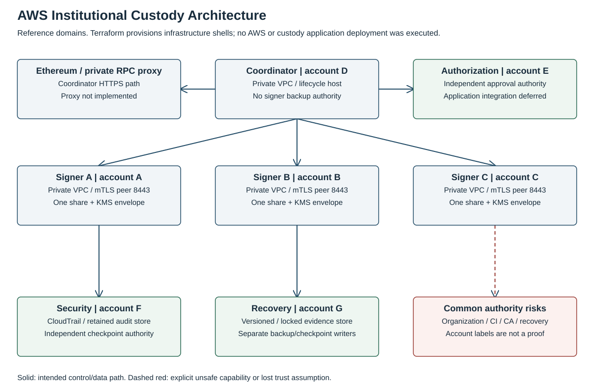
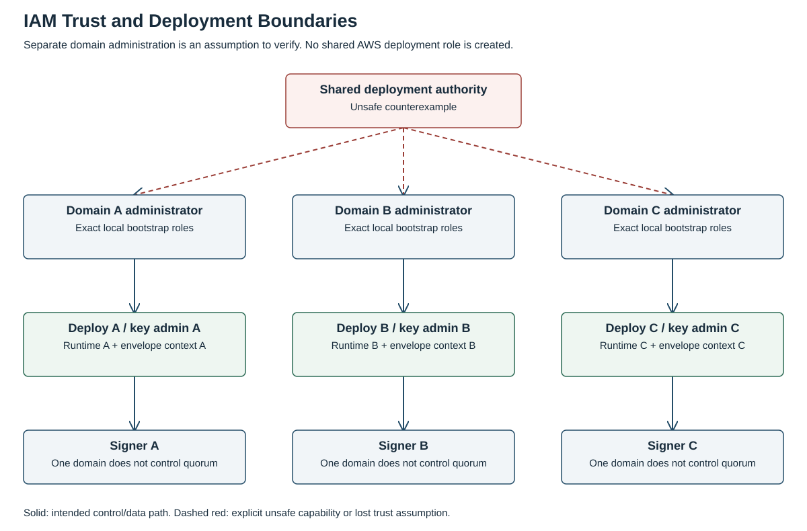
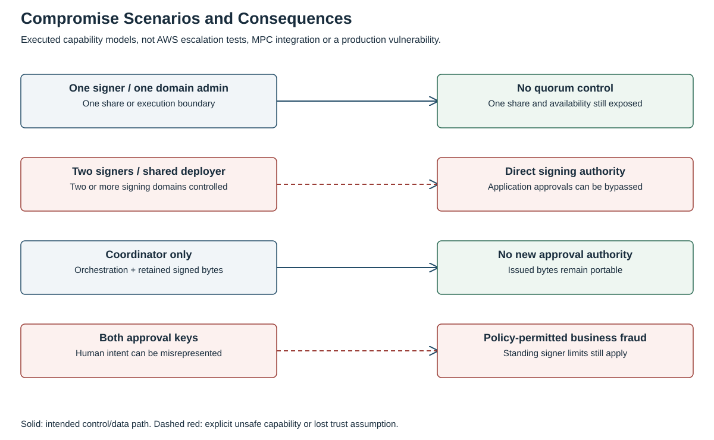
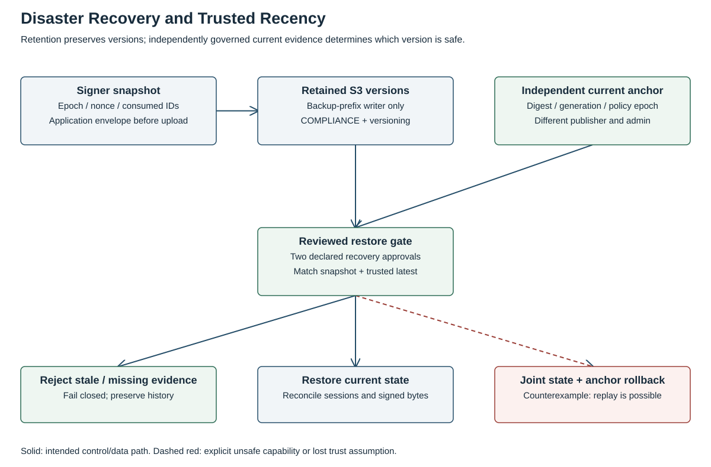

# AWS Institutional Custody Security Lab

### Exploring what happens when institutional custody security meets real cloud trust boundaries.

Can an institutional custody architecture preserve signing and authorization security when individual AWS accounts, IAM identities, signer hosts or recovery services are compromised?

This lab makes that question executable: modular Terraform, a declared authority graph, transaction-policy models, recovery counterexamples and plan assertions against the actual infrastructure definitions. Three accounts help only if one administrator, deployment pipeline or recovery path cannot quietly become all three signers. Counting account IDs is the easy part.

**[Architecture](architecture/overview.md)** · [Run the experiments](experiments/README.md) · [Validation report](VALIDATION_REPORT.md) · [Attack matrix](threat-model/attack-scenarios.md) · [Research index](https://github.com/demis1997/institutional-custody-security-research/blob/main/RESEARCH_INDEX.md)



*Reference architecture, not a deployed custody service. Solid arrows show representative intended paths; the common-authority box records an explicit risk. EC2 hosts contain no installed MPC or approval application.*

## Implemented

- **Seven Terraform modules** for network, identity, key protection, workload hosts, monitoring, evidence storage and organization guardrails. Four deployment roots let each domain use separately governed credentials and state.
- **Private workload infrastructure:** no public host IP, Internet/NAT gateway or SSH; explicit peer routes and TCP 8443 rules, private AWS API paths, encrypted storage and IMDSv2.
- **Scoped authority:** exact operator principals, domain-bound KMS envelope context, signer-only backup upload permissions and separately governed checkpoint/restore identities. No common AWS deployment role is created.
- **Audit and recovery definitions:** CloudTrail digest validation and cross-account delivery policy, VPC Flow Logs, selected EventBridge authority-change records, optional per-account GuardDuty, and private versioned Object Lock stores.
- **Executable compromise and recovery models:** one versus two signer compromises, shared deployment authority, approval-service compromise, budget history, policy epochs, replay and checkpoint rollback.
- **Automated checks:** Python tests, deterministic scenario records, Terraform formatting/validation, mocked plan assertions, secret scanning and a read-only GitHub validation workflow.

## What the tests establish

The model tests show one compromised signer is insufficient under the declared independent-control graph. Two compromised signers or a common deployer reach quorum control. A coordinator cannot invent approvals, but already issued ordinary signed bytes retain their own authority. A compromised service holding both approval keys can misrepresent business intent inside the standing policy.

Recovery rejects obsolete or missing independent evidence. The deliberately unsafe case rolls back both state and the trusted current anchor, then replays a consumed request successfully. That is the finding, not a passing claim about backup encryption.

Terraform tests inspect actual resource attributes and generated policy JSON using **mocked AWS providers and `command = plan`**. They include negative configuration cases. They do not prove that a service deployed or that AWS enforced a policy. [The validation report](VALIDATION_REPORT.md) records exact executed counts, commands and unexecuted work; [raw evidence](results/published/) is kept separate from fresh local runs.

## Security objectives and threat model

Keep signing participants, software release authority, approval/policy control and trusted recovery evidence independent under explicit attacker assumptions. Preserve current nonce, spending and consumed-approval history across recovery. Fail closed when a trusted checkpoint or quorum is unavailable.

[Assets and invariants](threat-model/assets.md) · [Attacker capabilities](threat-model/attacker-capabilities.md) · [Fourteen-scenario attack matrix](threat-model/attack-scenarios.md) · [Residual risks](threat-model/residual-risks.md)



*The shared-deployer path is an intentionally unsafe counterexample. It is not a role provisioned by these modules.*

## AWS choices and cryptographic boundary

IAM, private VPCs/endpoints, KMS envelope keys, CloudTrail, CloudWatch, optional GuardDuty, EventBridge and retained S3 evidence have specific jobs. The optional organization root supplies selected member-account guardrails. [Service decisions](architecture/service-decisions.md) explain each control and its remaining exposure; Config, Secrets Manager, CloudHSM and Nitro Enclaves are evaluated without adding unused deployments.

**Wrapping a share is not threshold signing inside hardware.** The pinned Quorum Custody adapter decrypts a serialized share in host memory before calling cb-mpc. Neither KMS Sign nor ordinary CloudHSM ECDSA support proves compatibility with that protocol. No CloudHSM, enclave, HSM-resident MPC or post quantum signer is implemented. Read [the interface analysis](architecture/key-protection.md).



## Reproduce locally

Requirements: Python 3.11 or newer, **Terraform 1.9.8**, Git and network access to download the pinned **AWS provider 5.100.0**. Python tests have no third-party dependencies.

```sh
git clone https://github.com/demis1997/aws-custody-security-lab.git
cd aws-custody-security-lab
bash scripts/validate.sh
```

The runner removes AWS credential/config environment variables from its child processes, disables metadata credential discovery and points AWS shared files to `/dev/null`. It initializes local modules/provider packages and runs only static/mocked checks. No AWS login, real cloud plan, apply or deployment is performed. Fresh logs and scenario JSON go to ignored `results/local/`.

To run just the policy/recovery model:

```sh
PYTHONPATH=experiments python3 -m unittest discover -s experiments/tests -v
python3 experiments/run.py
```

To scan intended publication files with [Gitleaks](https://github.com/gitleaks/gitleaks):

```sh
GITLEAKS_BIN=/path/to/gitleaks bash scripts/scan-secrets.sh
```

## Recovery is a state problem



Object Lock preserves versions; an independently governed current anchor determines which version is safe. S3 read access does not enforce the model's two-person restore decision. The application restore gate and live reconciliation remain integration work. [Recovery design and drill](architecture/recovery.md).

## Deployment status, costs and limitations

**No AWS infrastructure has been deployed.** The Terraform is real resource code validated with the provider schema, but examples contain synthetic account IDs, AMI placeholders and pre-existing role assumptions. Workload hosts are infrastructure shells without custody software, CA, database or RPC proxy. Live IAM, mTLS, CloudTrail delivery, S3 delete/retention, outage recovery and native MPC tests are **Not Executed**.

[Deployment prerequisites](terraform/README.md) require independent account/state ownership, reviewed images and roles, two-sided peering, application integration and explicit approval. `deployment_acknowledged` defaults to false. CI has no AWS credentials and no apply step.

EC2, endpoints, KMS, logs, GuardDuty and retained objects can incur charges. COMPLIANCE retention can prevent cleanup and continue storage charges. No cloud resources or paid experiments are authorized by running the local checks. Obtain a reviewed cost estimate and separate deployment approval before changing that boundary.

This is a research lab, not a production custodian, compliance certification, penetration-test report or hardware-security proof. [Limitations](research/limitations.md) · [Findings](research/findings.md) · [Future work](research/future-work.md).

## Related work

- [Quorum Custody](https://github.com/demis1997/quorum-custody): the separately maintained MPC implementation, referenced at `691e253ccdc2756afe215a23384eb72e2d4fde3c`.
- [Securing Institutional Digital Asset Custody — paper](https://github.com/demis1997/institutional-custody-security-research/blob/main/paper/custody-security-research.pdf): application authority, distributed state, recovery and quantum migration research.
- [Security Research Index](https://github.com/demis1997/institutional-custody-security-research/blob/main/RESEARCH_INDEX.md): publications, active research and contribution evidence.

Original lab code, diagrams and documentation: [MIT](LICENSE), Dimitris Konstantinou. Referenced AWS, Terraform and upstream cryptographic software retain their own terms. This repository vendors no MPC library or cloud binaries.
